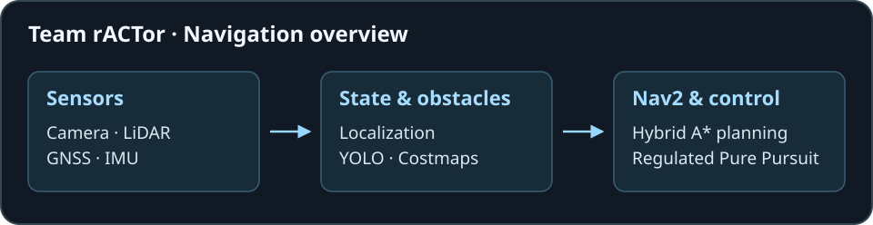

I'm **Ilyarzhan Assimov**, a machine learning engineer and M.S. Computer Science candidate at **Lawrence Technological University**. My work spans computer vision, autonomous navigation and control, and data analysis.

[LinkedIn](https://www.linkedin.com/in/ilyarzhan-assimov)

## Autonomous driving & robotics

### [SpARC Autonomous Racing](projects/sparc.md)

**1st place · Zero-Noise Time Trials · November 2026**

My three-person team took first place in simulation. I proposed and implemented sector-based speed optimization and helped tune the racing controller. Our best lap was **97.8 s**, down from the **174.0 s** provided baseline.

### [IGVC Self-Drive · Team rACTor](projects/igvc.md)

**1st place · Self-Drive Challenge · 2026**

I contributed to ROS 2 and Nav2 integration for LTU's four-wheel-steering vehicle, working on navigation and supporting YOLO-based perception.

## Machine learning & analytics

| Project | Focus |
| --- | --- |
| [Deepfake Detection Research](https://github.com/ilyarjan1/deepfake-detection-thesis) | Graduate research on whether AI-generated image detectors generalize to newer datasets. The repo tracks baseline reproduction, evaluation, and experiment status. |
| [Skin Lesion Classification](https://github.com/ilyarjan1/Skin_Cancer_dl) | Medical image classification with TensorFlow and EfficientNet, part of my undergraduate research. |
| [F1 Race Strategy Decision Engine](https://github.com/ilyarjan1/f1-race-strategy-decision-engine) | A Python dashboard for exploring pit windows, tire recommendations, and comparable race situations. |

**Tools and methods** · Python, NumPy, TensorFlow, scikit-learn, OpenCV, YOLO, ROS 2, Nav2, Gazebo, RViz2
