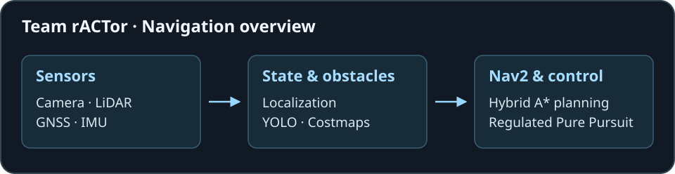

# IGVC Self-Drive · Team rACTor

**First place in the 2026 Intelligent Ground Vehicle Competition Self-Drive Challenge**

[← Profile README](../README.md)

I contributed to the autonomous navigation stack and robotic system design for Lawrence Technological University's four-wheel-steering vehicle. My work included ROS 2 and Nav2 integration, path planning, and support for the perception team.

## Engineering highlights

- **Navigation.** I worked on integration with a Nav2 stack using Hybrid A* for feasible paths and Regulated Pure Pursuit for path tracking.
- **Perception.** I assisted with YOLO-based detection of pedestrians and obstacles. The team integrated camera and LiDAR inputs with localization and obstacle representation.
- **Testing.** I contributed to development across simulation and physical testing. The diagram summarizes the team's system and simplifies its sensor and control interfaces.
