# SpARC Autonomous Racing

**First place in the Zero-Noise Time Trials · November 21, 2026**

[← Profile README](../README.md)

My three-person team competed in a Python-based autonomous racing simulation hackathon organized by the Spartans Autonomous Racing Club. Our optimized controller completed a lap in **97.8 seconds**, a **43.8% reduction** from the provided 174.0-second baseline. We set the fastest lap-time and won 1st place

## My contribution

- Proposed and implemented sector-based speed optimization. Different parts of the track used different lateral acceleration, braking, and speed constraints.
- Helped replace centerline following with a minimum-curvature racing line within the track boundaries.
- Helped tune adaptive Pure Pursuit steering, speed preview, and PI throttle and brake control. The speed profile used a forward acceleration pass and a backward braking pass.

The lap times describe the simulated Zero-Noise event. The chart compares the two recorded results.
